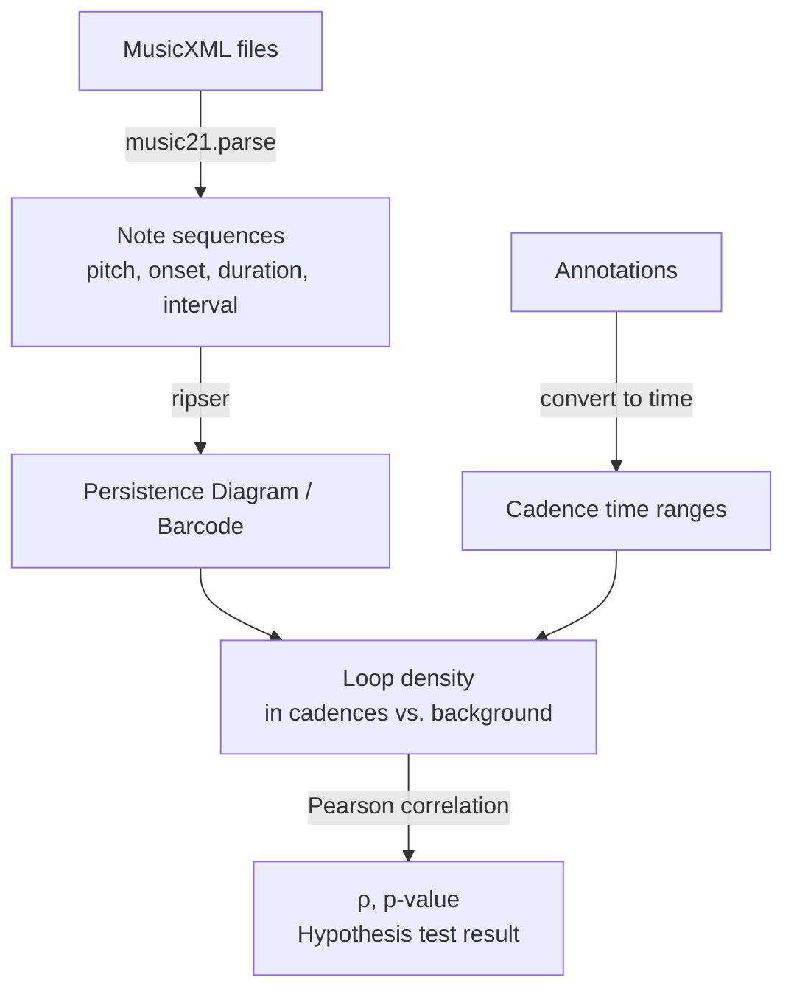

# Proposal

Techniques from topological data analysis (TDA) will be applied to analyze pitch structure in classical music, examining whether traditional harmonic and melodic concepts manifest as persistent topological features.

## Core Idea: 

1. Convert musical notes into point clouds
2. compute persistent homology (PH) diagrams
3.  perform hypothesis testing to validate that detected topological loops align with music-theoretic harmonic structures (e.g. cadences, chord progressions, phrase boundaries).

## Research Questions:

1. Do standard harmonic structures (e.g., $\text{V-I}$ authentic cadences) consistently appear as loops in persistence diagrams? In which dimensions?
2. Are topological signatures consistent within a single composer/genre, and distinct across composers/genres?
3. What embedding and feature extraction choices best capture musically meaningful structure?

# Proposed Methods
## Hypothesis Tests

**Null control test ($H_{0}$):**  Loop density and cadence density are independent ($ρ = 0$).
- Shuffle cadence annotations (permute measure ranges) while keeping loop data fixed
- Recompute $ρ$ on shuffled data; repeat 1000 times
- Report observed $ρ$ vs. distribution of permuted $ρ$ values; empirical $p$-value

**Alternative hypothesis ($H_{1}$):** Annotated harmonic cadences in sheet music correspond to births and deaths loops in persistence diagrams ($ρ > 0$).

**Test procedure:**
1. **Roman Numeral Analysis**: Annotate 5 pieces per (composer, genre) pair with the key and chords of every measure
	1. Either manually, professionally, or computationally 
2. For each piece:
	   1. Convert notes into point cloud; Features = (pitch, onset, duration, interval from prev. note)
	   2. Compute persistence diagram via persistent homology
	   3. Record topological features (birth time, death time)
	   4. Compute loop density in annotated cadence regions vs. non-cadence regions
	   5. Measure correlation $\rho$ between musical structure density and loop density
3. **Rejection threshold:** $ρ ≥ 0.50, p < 0.05$ per (composer, genre) pair indicates $H_{0}$ is rejected; topological loops track harmonic structure
	1. Better thresholds may be chosen later

Example: Testing Cadences

# Prior Work
The only application of TDA (specifically Persistent Homology) in musicology I've found is:

> Mattia G. Bergomi, Adriano Baraté, Barbara Di Fabio.
 (2016) Towards a topological fingerprint of music.  https://doi.org/10.48550/arXiv.1602.00739

Bergomi et al. propose representing musical compositions as deformed geometric surfaces derived from the *Tonnetz*, a classical music-theory graph where pitch classes are vertices. 

They warp this flat graph into 3D space by lifting each pitch class's height according to how long that pitch is played throughout the piece. Structurally central notes become tall peaks, while passing tones stay low.

Persistent Homology is then applied, extracting persistence diagrams which fingerprint each composition's harmonic character. 

The method successfully utilized these diagrams in hierarchical clustering to 
1. Segregate tonal music (Mozart, Beethoven) from atonal works (Schönberg, Ravel) 
 2. And further applied it to 58 pop songs; pieces from artists with coherent styles (Beatles, Simon & Garfunkel) were shown to cluster tightly, while stylistically diverse artists (Sting) scatter

# Novel Contributions

The deformed Tonnetz method in Bergomi et al. only captures which pitches are important (via duration), not in what order they appear or how they connect temporally. Indeed, the authors themselves list encoding the temporal dimension of notes to create higher order deformations as future work.

The proposed project differs by encoding the onset (or location in music) of each note into the data from the beginning, allowing for the analysis of harmonic progression.

# Datasets to Explore

For each (composer, genre) pair, 5 pieces would be selected.

For a proof of concept, symbolic music (MusicXML files) would be explored. The pitches and rhythm of songs are already neatly laid out in them, which will make the project more straight forward.

| Composer           | Genre     | Primary Source                                                 | Fallback                                                                                                                                       | Harmonic Annotation                                                                |
| ------------------ | --------- | -------------------------------------------------------------- | ---------------------------------------------------------------------------------------------------------------------------------------------- | ---------------------------------------------------------------------------------- |
| **Bach**           | Classical | kernscores.stanford.edu (`.krn` + `**harm` spine if available) | GitHub [bach-chorales repo](https://musescore.com/sheetmusic/free-download) or [musescore.com](https://musescore.com/sheetmusic/free-download) | Extract from `**harm` spine; if unavailable, use `music21.analysis.reduceChords()` |
| **Jean Sibelius**  | Classical | [IMSLP](https://imslp.org/wiki/Main_Page)                      | [musescore.com](https://musescore.com/sheetmusic/free-download)                                                                                | Computed  with `music21.analysis.reduceChords()`                                   |
| **Duke Ellington** | Jazz      | [Primary source TBD]                                           | [musescore.com](https://musescore.com/sheetmusic/free-download)                                                                                | [TBD]                                                                              |
| **Dream Theatre**  | Metal     | [Primary source TBD]                                           | [musescore.com](https://musescore.com/sheetmusic/free-download)                                                                                | [TBD]                                                                              |

> Remark: Actual sheet music may be arranged by someone different than composer.

If time allows, I'd like to work with raw audio files of songs. However, I have very little experience with signal processing, which may make this unfeasible. Corresponding performances of the pieces could be downloaded from Spotify Premium.
# Deliverables

- GitHub repository with:
	- Cleaned datasets (MusicXML + annotation files)
	- Jupyter notebook: full analysis + visualizations
	- Technical report: methods, results, interpretation
- Figures: persistence diagrams (3–5 per genre/composer); correlation table
---
# Glossary

| Tool      | Purpose                                                                                                                                         |
| --------- | ----------------------------------------------------------------------------------------------------------------------------------------------- |
| `music21` | Parse MusicXML; extract note sequences; analyze chords via `analysis.reduceChords()`                                                            |
| `ripser`  | Compute persistent homology (Rips complex) and persistence diagrams                                                                             |
| Humdrum   | Symbolic music format (`.krn` files); includes **spines** (data columns) such as `**harm` containing professionally-annotated harmonic analysis |
| IMSLP     | International Music Score Library Project: library of online public domain scores; mostly PDFs, but can usually be converted to MusicXML        |

